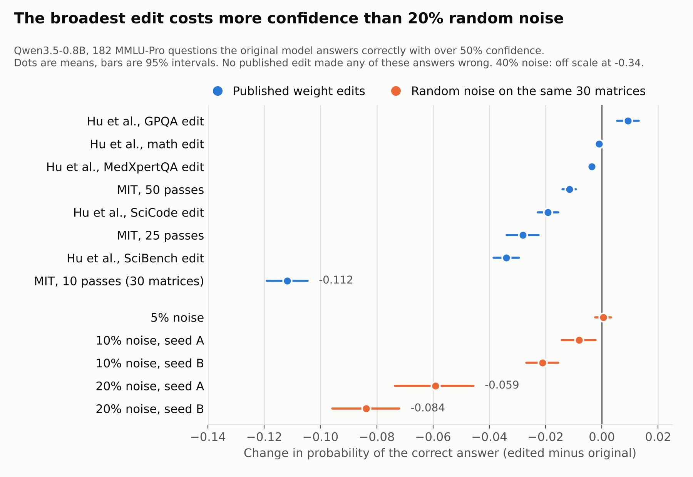

# weight-edit-retention

A loop-free test of whether published weight-space programming edits to
Qwen3.5-0.8B reduce what the model knows.

**Result.** On a loop-free test, no published edit made the model answer firmly known
questions wrongly. Seven of the eight distinct edits cost less confidence than 20% random
noise, and the narrowest cost almost nothing. The broadest edit (30 matrices) lowers
confidence more than 20% random noise on the same matrices, uniformly across questions.
Accuracy alone hides all of this: 20% random noise also passes the accuracy test.



The work ran in three stages, each committed before the next:

1. **First run** (1,000 questions): accuracy, with rules fixed in advance. No edit changed it.
2. **Positive controls:** showed that accuracy detects large damage and misses moderate damage.
3. **Confirmatory run** (2,000 fresh questions): a sharper measure, pre-registered in
   `PREREGISTRATION_confirm.md`. All three hypotheses passed.

Write-up: _add link_

## Background

Two groups showed that a frontier model can read the weights of a small model
and edit a few values to raise its benchmark scores, with no gradient descent:

- Takehi, Teoh, Zhang, Khattab, [Sparks of Weight-Space Programming](https://rikiyat.github.io/blog/weight-space-programming/) (MIT CSAIL, November 2026)
- Hu et al., [Exploring Weight-Space Programming: Capabilities, Generalization, and Limitations](https://arxiv.org/abs/2611.09382) (November 2026)

All their evaluations ran with thinking on and a 32,768-token limit. The
unedited 0.8B model often loops until that limit and gives no answer. An edit
that stops the looping raises the score even if the model knows nothing new, and
that gain could hide a loss of knowledge. This repository tests for such a loss.

## Method

- **Model:** `Qwen/Qwen3.5-0.8B` at revision `2fc0636`, the one both groups edited.
- **Data:** the 1,000 MMLU-Pro test questions the MIT group used (`mmlupro_1k_ids.json`).
- **Scoring:** thinking off. The assistant turn starts with `The answer is (`.
  The probability of each option letter as the next token is read, and the
  highest wins. One token, no sampling: the model cannot loop and a rerun gives
  the same numbers.
- **Comparison:** paired. Each edited model against base on the same questions.

## Edits tested

| Name | Source | What it changes | Values changed |
|---|---|---|---|
| mit_p10c | MIT, 10 passes | loop direction removed from 30 matrices | 72,986,982 |
| mit_p25c | MIT, 25 passes | attention head 7 of layer 15 set to zero | 262,144 |
| mit_p50c | MIT, 50 passes | 64 columns each in two MLP layers | 130,188 |
| ws_math_primary | Hu et al. | one column of layer 23, "doubt minus progress" direction | 1,023 |
| ws_gpqa | Hu et al. | head 6 of layer 15 set to zero | 262,144 |
| ws_mmlupro | Hu et al. | head 7 of layer 15 set to zero (identical to mit_p25c) | 262,144 |
| ws_medxpertqa | Hu et al. | 21 MLP columns doubled | 21,504 |
| ws_scibench | Hu et al. | three heads halved, one column negated | 787,456 |
| ws_scicode | Hu et al. | one column scaled by -2, one head set to zero | 263,168 |
| ctrl_random | control | random direction, same column and norm as ws_math_primary | 1,024 |

The MIT edits are rebuilt from their released files and checked against their
sha256 hashes. The Hu et al. edits are rebuilt from the formulas in their
Appendix C and checked against the changed-value counts they report. Three of
their 0.8B edits (IFEval, Math reruns 1 and 2) need activation traces that were
not released, so they are not included.

## Rules fixed before the run

- **Null hypothesis:** an edited model has the same accuracy as base.
- **Damage:** accuracy at least 2.0 points below base, and an exact sign test on
  flips with p below 0.05 divided by the number of edits tested.
- **No change:** the 95% interval of the difference lies inside plus or minus 2.0 points.
- **Otherwise:** inconclusive.
- **Control:** `ctrl_random` shows how far a meaningless edit of the same size moves the score.
- **Validity:** base accuracy clearly above chance, and most probability on valid letters.

## Positive controls

Added on 18 November 2026, after the main run and before their results were
seen. A "no change" result means little if the test cannot detect damage, so
five deliberately harmful edits are scored the same way:

- `ctrl_damage_noise05`, `10`, `20`, `40`: multiplicative Gaussian noise of 5%,
  10%, 20%, and 40% on the same 30 matrices the broadest published edit touches.
- `ctrl_damage_zero_attn15`: all eight attention heads of layer 15 set to zero
  (the published edits zero one).

**Prediction written before the run:** accuracy falls as noise rises, and at
least the 20% and 40% noise controls meet the "damage" rule. If no control
shows damage, the test is too blunt and the main result says little.

**Outcome (18 November):** the prediction was half right. 40% noise (-7.0 points) and zeroed
layer-15 attention (-12.3 points) meet the damage rule. 20% noise does not: it changes 36% of
the answers and leaves accuracy at 24.7%. So accuracy on this test detects large damage and
misses moderate damage. A sharper measure and a confirmatory run on fresh questions are
specified in `PREREGISTRATION_confirm.md`.

## Results of the first run (accuracy)

Base accuracy 24.7% (chance 11.1%). Probability mass on valid letters 0.999.

| Edit | Accuracy | Change | 95% interval | Right to wrong | Wrong to right | Verdict |
|---|---|---|---|---|---|---|
| ctrl_random | 24.6 | -0.1 | -0.5 to +0.3 | 3 | 2 | no change |
| mit_p10c | 24.4 | -0.3 | -1.7 to +1.0 | 25 | 22 | no change |
| mit_p25c | 25.0 | +0.3 | -0.9 to +1.5 | 17 | 20 | no change |
| mit_p50c | 24.4 | -0.3 | -1.1 to +0.5 | 10 | 7 | no change |
| ws_gpqa | 24.8 | +0.1 | -1.1 to +1.4 | 20 | 21 | no change |
| ws_math_primary | 24.6 | -0.1 | -0.6 to +0.4 | 4 | 3 | no change |
| ws_medxpertqa | 24.7 | 0.0 | -0.6 to +0.5 | 4 | 4 | no change |
| ws_mmlupro | 25.0 | +0.3 | -0.9 to +1.5 | 17 | 20 | no change |
| ws_scibench | 24.8 | +0.1 | -1.0 to +1.2 | 16 | 17 | no change |
| ws_scicode | 24.3 | -0.4 | -1.6 to +0.7 | 19 | 15 | no change |

Full output: `results/analysis.txt`. Per-question files: `results/*.jsonl`.

### Exploratory observations (not planned before the run)

- The larger edits change the chosen letter on 11 to 15% of questions (control:
  1%). About 70% of those changes go from one wrong answer to another.
- On the 79 questions the base model answers correctly with probability above
  0.5, every edit keeps all 79 correct.
- `mit_p10c`, the broadest edit, lowers the probability of the correct answer on
  those 79 questions from 0.68 to 0.57. No other edit does.
- `ws_mmlupro` and `mit_p25c` are the same edit, found by two independent searches.

Run `python extra_checks.py` to reproduce these.

## Confirmatory run (19 November 2026)

2,000 MMLU-Pro questions not used in the first run. The pre-registration was committed
during the run, before any result was seen (commit `cf0dc00`).

**Primary set:** the 182 questions the base model answers correctly with probability above 0.5.
**Primary measure:** mean change in the probability of the correct option on that set.

| Variant | Change in p(correct) | 95% interval | Kept correct | Accuracy change (all 2,000) |
|---|---|---|---|---|
| Noise 5% | 0.000 | -0.002 to +0.003 | 100% | 0.0 |
| Noise 10%, seed A | -0.008 | -0.014 to -0.002 | 100% | +0.2 |
| Noise 10%, seed B | -0.021 | -0.027 to -0.015 | 100% | -0.6 |
| Noise 20%, seed A | -0.059 | -0.073 to -0.046 | 97.3% | -0.4 |
| Noise 20%, seed B | -0.084 | -0.096 to -0.072 | 97.8% | -1.9 |
| Noise 40% | -0.339 | -0.366 to -0.312 | 72.5% | -7.0 |
| Layer 15 attention zeroed | -0.547 | -0.569 to -0.523 | 31.9% | -12.0 |
| Random direction control | 0.000 | 0.000 to 0.000 | 100% | +0.1 |
| mit_p10c | -0.112 | -0.119 to -0.105 | 100% | -0.2 |
| ws_scibench | -0.034 | -0.038 to -0.030 | 100% | +0.2 |
| mit_p25c | -0.028 | -0.034 to -0.022 | 100% | +0.5 |
| ws_scicode | -0.019 | -0.023 to -0.016 | 100% | +0.4 |
| mit_p50c | -0.012 | -0.014 to -0.009 | 100% | -0.1 |
| ws_medxpertqa | -0.004 | -0.004 to -0.003 | 100% | +0.1 |
| ws_math_primary | -0.001 | -0.001 to -0.001 | 100% | 0.0 |
| ws_gpqa | +0.009 | +0.006 to +0.013 | 100% | +0.7 |

- **H1, calibration: pass.** The drop grows with the noise level.
- **H2, the broad edit: pass.** `mit_p10c` lowers confidence more than 10% noise on both
  seeds (differences -0.104 and -0.091, intervals excluding zero).
- **H3, the other edits: pass.** Each lowers confidence less than 20% noise on both seeds.

The values match the first run closely (`mit_p10c`: -0.110 then, -0.112 now).

Not pre-registered, descriptive: `mit_p10c` also exceeds both 20% noise seeds. It lowers
confidence on all 182 questions by a similar amount and flips none, while 20% noise lowers
it on about 75% of them, unevenly, and flips a few. The edit itself is 4.8% of the norm of
the weights it touches; random noise of 5% has no measurable effect.

Full output: `results_confirm/analysis_confirm.txt`. Redraw the figure with `python make_figure.py`.

## Limits

- With thinking off the base model scores 24.7%, against 40.3% with thinking on.
  This test sees only knowledge the model can state at once.
- One model, one benchmark, one prompt format.
- Lower confidence with thinking off may or may not mean more wrong answers when the
  model samples with thinking on. That is not tested.
- Noise results vary by seed, so comparisons to noise are rough.
- Plasticity (can the edited model still be fine-tuned as well) is not tested.

## Reproduce

Free Colab T4 GPU, about 26 minutes: open `retention_colab.ipynb` and follow the
first cell.

Or locally with a GPU:

```
pip install -r requirements.txt
python run_retention.py --limit 50 --out results_smoke   # quick check
python run_retention.py --out results_rerun
python analyze.py results_rerun
python extra_checks.py results_rerun
```

An 8 GB Apple laptop is too slow for this model's reference implementation.

## Files

- `edits.py`: rebuilds every edit as bfloat16 bit patterns (numpy only).
- `run_retention.py`: loads the model, applies each edit, scores the questions.
- `analyze.py`: the paired comparison and the verdict rules.
- `extra_checks.py`: the exploratory observations.
- `PREREGISTRATION_confirm.md`, `analyze_confirm.py`, `confirm_colab.ipynb`: the confirmatory run.
- `positive_control_colab.ipynb`: the positive-control run.
- `results_confirm/`: per-question outputs of the confirmatory run.
- `make_figure.py`, `figures/`: the chart above.
- `mit_edits/`: edit files from the MIT group.
- `results/`: per-question outputs from the run reported here (Colab T4, 17 November 2026).

## Credits and licence

Code: MIT licence (see `LICENSE`).

`mit_edits/` and `mmlupro_1k_ids.json` are derived from
[RikiyaT/lm_understand-logs](https://github.com/RikiyaT/lm_understand-logs)
by Takehi, Teoh, Zhang, and Khattab, licensed CC BY 4.0. Edit formulas are from
Hu et al., arXiv 2611.09382. MMLU-Pro is from TIGER-Lab.
